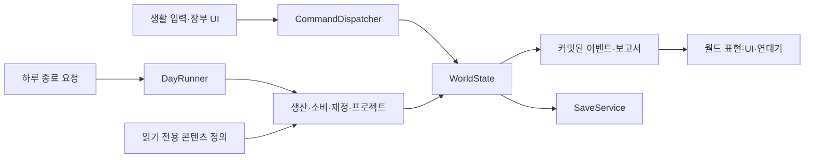

# 4. 기술 아키텍처

## 기본 결정

Godot 4.x 안정판과 타입을 지정한 GDScript를 사용한다. 정확한 엔진 패치 버전은 첫 실행 빌드에서 설치·검증한 뒤 `docs/production/toolchain.md`에 고정한다. 현재는 엔진 설치와 버전 검증을 하지 않았으며 실행 파일도 PATH에서 확인되지 않았다.

단일 플레이·로컬 저장·탑다운 2D·데이터 중심 설계다. 초기에 범용 ECS, 네트워크 추상화, 모든 미래 시스템의 빈 클래스를 만들지 않는다.

## 예정 폴더 구조

```text
project.godot
src/
  bootstrap/              # GameRoot, 새 게임·씬 전환·의존성 구성
  domain/
    state/                # WorldState, CharacterState, BuildingState
    commands/             # DepositItems, AssignWorker, ContributeWork
    systems/              # Production, Consumption, Tax, Project, Calendar
    events/               # DomainEvent, EventQueue
  application/            # GameSession, DayRunner, CommandDispatcher
  infrastructure/
    content/              # 정의 로더·참조 검증
    save/                 # 직렬화·슬롯·마이그레이션
  presentation/
    world/                # Player, NPCView, InteractionTarget
    ui/                   # HUD, Ledger, DayReport, Inventory
scenes/{bootstrap,world,ui}/
data/
  definitions/{items,recipes,buildings,characters,events}/
  scenarios/              # initial_estate
  design/                 # 현재의 경제 설계 검증 자료, 런타임과 구분
assets/{tiles,characters,ui,audio,fonts}/
tests/{unit,integration,fixtures}/
tools/
docs/{design,production,templates}/
```

이 트리는 구현 지침이지 현재 구현 목록이 아니다. 첫 작업에서 필요한 폴더만 만든다. 테스트 도구는 우선 Godot headless용 간단한 SceneTree 실행기이며 외부 프레임워크는 필요를 확인한 뒤 도입한다.

## 의존성과 책임



UI가 재고 Dictionary를 직접 수정하지 않는다. NPC 노드와 건물 노드는 표현이며 상태의 원본은 WorldState다. 시스템은 다른 시스템의 private 상태나 씬 경로를 찾지 않는다. 상태와 정의, 필요한 서비스를 명시적으로 인자로 받는다.

| 구성 | 책임 | 소유하지 않는 것 |
|---|---|---|
| GameSession | WorldState·콘텐츠·서비스 생명주기 | NPC 개별 경로 탐색 |
| CommandDispatcher | 조건 검사·거래·중복 명령 거부 | 버튼 표시 |
| InventoryService | 보유/예약/이동·용량 원자성 | 생산 속도·UI |
| ProjectSystem | 작업량·재료 예약·담당자·완료 상태 | 직접 작업 애니메이션 |
| ProductionSystem | 작업자/원료/용량별 배치 | 화면에 보이는 NPC 위치 |
| PopulationSystem | 노동 자격·가구·소비·신뢰 | sprite 생명주기 |
| EconomySystem | 세금·유지비·수동 거래 원장 | 전체 거시 시장 |
| DayRunner | 처리 순서·결산 ID·커밋 | UI 순서에 따른 임의 tick |
| SaveService | 검증·직렬화·복구·마이그레이션 | 노드 그대로 저장 |
| Chronicle | 중요한 도메인 사건의 기록 | 게임 규칙 실행 |

초기 Autoload는 필요한 경우 GameSession 하나와 사용자 설정만 사용한다. 모듈별 매니저 수십 개를 전역으로 만들지 않는다.

## 필수 데이터 모델

정의 데이터는 JSON을 원본으로 사용하고 로딩 시 타입 있는 RefCounted 정의 객체로 변환한다. Inspector 편의가 필요한 아트 연결만 Resource로 관리한다. 같은 경제 값을 JSON과 `.tres`에 중복 작성하지 않는다. Godot Resource의 공유 인스턴스를 런타임 개별 건물 상태로 수정하지 않는다([공식 Resource 문서](https://docs.godotengine.org/en/stable/tutorials/scripting/resources.html)).

| 모델 | 핵심 필드 |
|---|---|
| ItemDef | id, name_key, category, stack_limit, edible_value, base_price |
| RecipeDef | id, inputs[], outputs[], batches_per_worker_day, stage |
| BuildingDef | id, cost, work_required, worker_slots, upkeep, recipe_id |
| CharacterDef | id, name_key, household_id, traits[], background_key |
| EventDef | id, conditions[], choices[], effects[], cooldown_days, repeatable |
| WorldState | date, inventory, treasury, households, characters, buildings, projects, flags, journal |
| CharacterState | id, job_id, skill, trust, relations, assignment_id, schedule_anchor |
| BuildingState | instance_id, definition_id, plot_id, status, workers[], unpaid_days, remainder |
| ProjectState | id, issue_id, target_id, state, required_work, done_work, reservations[], assignees[], rewarded |
| InventoryState | owner_id, items, reserved_by_project, capacity |
| SaveEnvelope | schema_version, content_version, engine_version, build_id, last_committed_day, world, rng_states |

정의 ID는 `item.wheat`, 인스턴스는 `building.mill.001`, 인물은 `character.toma`처럼 서로 다른 네임스페이스를 쓴다. 표시 이름·번역문·노드 경로를 ID로 쓰지 않는다. 참조 무결성·중복 ID·음수 비용·존재하지 않는 레시피·생산 순환을 시작 시 검증한다.

예시 레시피 계약(초안):

```json
{
  "id": "recipe.bread",
  "stage": 30,
  "inputs": {"item.flour": 8, "item.wood": 1},
  "outputs": {"item.bread": 10},
  "batches_per_worker_day": 2
}
```

기본 수량·금화·작업량은 정수. 보너스 계산은 basis points(10000=100%)로 수행하고 나머지는 상태에 저장한다. 창고 입출고는 검증→전체 차감/추가를 한 트랜잭션으로 적용해 부분 납품으로 물자가 사라지지 않게 한다.

## 프로젝트와 명령

상태 전이: `open → funded → in_progress → completed`, 또는 정책에 따른 `cancelled`. 완료·취소는 종료 상태다. 재료는 `available = owned - reserved`로 검사하고 예약은 하나의 원장에서만 관리한다.

직접 작업 `ContributeWork(project_id, effort)`와 위임의 일일 `ApplyAssignedWork(project_id)`는 같은 잔여 작업량을 줄인다. 작업량은 required_work를 넘지 않고 완료 시 예약 재료를 정확히 한 번 소비한다. 완료한 프로젝트에 다시 작업하면 실패 결과를 반환하며 보상을 추가하지 않는다. 노동자의 프로젝트 배치는 시설 배치와 동시에 존재할 수 없다.

수리 완료가 일일 결산 중 발생하면 그날 생산을 소급해 주지 않고 다음 날부터 가동한다. 직접 수리로 낮에 완료하면 그날 결산 생산에 참여한다. UI에 이 차이를 보여준다. 결산 시작 시 시설 가동 상태를 캡처하여 순서에 따른 모호함을 없앤다.

## 시간과 시뮬레이션

생활 시계는 `_process`에서 경과만 누적한다. 이동·충돌은 `_physics_process`에서 처리한다. 경제는 어떤 프레임 콜백에서도 계산하지 않는다. 일정 변경은 게임 내 아침/낮/저녁 경계에서만 갱신한다.

하루 종료 처리 순서:

1. 입력 잠금, 종료 요청의 일자 ID 검사, 유효 명령을 모두 반영한 작업용 상태 복사 생성.
2. 끝나는 날 계절과 시설 상태, 노동 배치 스냅샷 확정.
3. 1차 자원 생산 → 제분 → 제빵·제련 순서, 같은 단계는 인스턴스 ID 순서.
4. 주민 식량 소비, 결식 수량과 신뢰 변화 계산.
5. 가구 세금 징수 → 유지비 처리 → 미납 일수 갱신.
6. 위임/건설 작업 진행과 완료, 결과 적용. 새 시설은 다음 날 생산.
7. 의뢰·사건 조건 평가, 중요 사건 대기열 생성. 선택이 필요한 사건은 다음 날 UI에 노출하며 자동 선택하지 않는다.
8. 날짜 증가, 계절/연도 경계 이벤트, 일일 채집·일정 상태 갱신.
9. 상태 불변식 검증 → 새 상태와 결산 ID 원자적 커밋 → 저장 → 보고서 표시.

단계 실패 시 작업 사본을 폐기하고 이전 상태와 날짜를 보존한다. 저장 실패는 메모리 결산을 되돌려 재실행하지 않는다. ‘결산 완료·저장 실패’를 명확히 알리고 저장 재시도만 제공한다. 재시작 시 마지막 유효 저장에서 다시 플레이한다. 전날 저장부터 다시 진행하는 것은 정상이며 동일 실행 상태에서 같은 일자를 두 번 결산하는 것과 구별한다.

향후 월 단위 정책·공납은 `MonthEnded`에 대응시키되 하루 소비를 생략하지 않는다. 빠른 진행은 일일 tick 반복으로 먼저 구현하고 중요 사건·위기·플레이어 지정일에 멈춘다. 개인 일정과 장기 국가 시간의 배율은 별도 검증 후 결정한다.

## 이벤트

이벤트 예: `InventoryChanged`, `ProjectCompleted`, `BuildingActivated`, `CharacterAppointed`, `DayCommitted`, `SeasonChanged`. 공통 필드: `event_id`, `event_type`, `day_index`, `actor_ids`, `target_ids`, `payload`, `payload_version`.

명령은 상태를 변경하고 결과를 커밋한 뒤 이벤트를 발행한다. UI 구독자는 표시만 한다. 이벤트 수신 중 재귀적으로 경제 명령을 실행하지 않는다. 연대기는 동일 event_id 중복 기록을 거부한다. MVP는 메모리 큐+최종 상태 저장이며 전체 event sourcing은 쓰지 않는다. 미해결 선택 사건은 저장한다.

## 저장과 불러오기

`user://saves/slot_01.json` 등의 사용자 쓰기 경로를 사용한다. JSON의 한계를 고려해 Vector2는 좌표 배열, enum은 안정 문자열로 변환한다([Godot 저장 가이드](https://docs.godotengine.org/en/stable/tutorials/io/saving_games.html)).

- 저장 시 명령 처리와 결산이 끝난 안정 시점의 스냅샷을 얻는다. 낮의 수동 저장도 현재 시각·플레이어 위치·채집 상태·진행 중 프로젝트를 포함한다.
- 임시 파일에 쓰기→flush/close→다시 읽어 스키마 검증→기존 유효 파일을 백업→최종 이름 교체. 실제 교체와 전원 차단 내구성은 OS별 테스트하며 무조건 원자적이라고 가정하지 않는다.
- 불러오기는 후보 파일 파싱→버전 확인→연속 마이그레이션→참조/불변식 검증→새 상태 구성→씬에 반영한다. 실패 시 현재 플레이를 덮어쓰지 않는다.
- `schema_version`은 저장 구조, `content_version`은 정의 변경을 추적한다. 최초 스키마는 1이다. 미래 버전 저장은 거부하고 원본을 보존한다.
- 구버전은 `v1_to_v2`와 같이 작은 순서 변환으로 처리하고 원본 백업과 fixture 테스트를 유지한다. 삭제된 콘텐츠 ID는 명시 alias/환급 정책으로 처리하며 알 수 없는 항목을 조용히 버리지 않는다.
- 무작위는 시뮬레이션과 연출의 RNG를 분리한다. RNG seed/state의 64비트 값은 JSON에서 정밀도를 잃지 않도록 십진 문자열로 저장한다. 엔진 RNG 알고리즘은 구현 세부사항이므로 엔진 버전 간 동일 재생을 보장하지 않는다([공식 RNG 문서](https://docs.godotengine.org/en/stable/classes/class_randomnumbergenerator.html)).
- 파일에는 코드나 실행 가능한 객체를 넣지 않는다. 민감한 사용자 정보도 저장할 이유가 없다.

## 테스트와 관측

도메인: 자원 보존, 예약 수량 한도, 정수 배치, 식량 부족, 동일 인물 중복 배치 거부, 프로젝트 종료 상태, 결산 중복 방지.

통합: 첫 제분소 복구의 직접/위임 경로, 저장 후 동일 날짜와 재고, 결산 중 오류 롤백, 저장 실패 재시도, 56일 계절 경계, 미납 유예/복구, 창고 가득 참.

수동: 조작감·장부 일시 정지·대사·사운드·화면 배율·목표 전달·엔딩. headless 성공은 시각/조작 테스트 성공으로 표현하지 않는다.

각 결산에 생산 전후 재고·원인별 변화·인력·처리시간을 개발 로그로 남긴다. 동일 시드와 명령열의 동일 버전 재현을 확보한다. 성능 최적화는 프로파일링 후 시행하며 화면 밖 NPC 노드는 비활성화하되 도메인 주민을 삭제하지 않는다.
